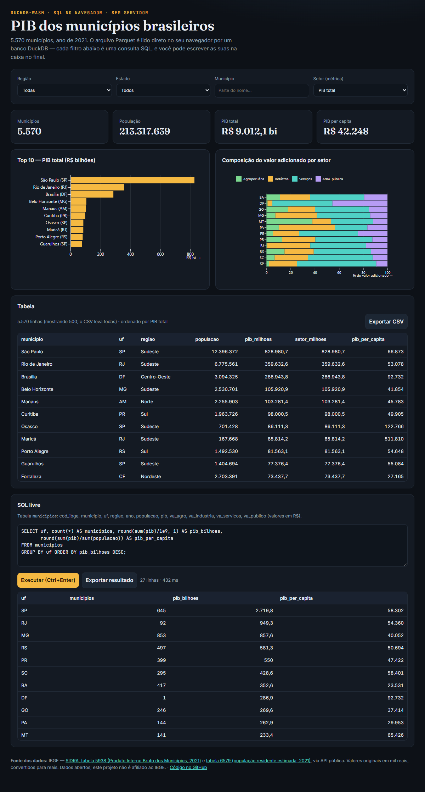

# PIB dos municípios — DuckDB-WASM

**PT** · [EN](#en)

Painel analítico do PIB dos 5.570 municípios brasileiros (IBGE, 2021) que roda **inteiro no navegador**: um banco DuckDB compilado para WebAssembly lê um arquivo Parquet de 250 KB e responde a cada filtro com SQL. Não há servidor, API nem build.

**Demo:** https://alissonlittig.github.io/duckdb-dados-publicos/



## O que tem
- Filtros por região, estado, município (busca sem acento) e setor (agropecuária, indústria, serviços, administração pública).
- Indicadores, ranking e composição setorial (Observable Plot).
- Tabela com exportação em CSV.
- Caixa de **SQL livre** sobre a tabela `municipios`, com exportação do resultado.

## Stack
DuckDB-WASM · Parquet (zstd) · Observable Plot · HTML/CSS/JS puro · Python (pyarrow) para gerar o Parquet · GitHub Pages.

## Como rodar
```bash
python -m http.server 8000     # na raiz do projeto
# abra http://localhost:8000
```
Para refazer os dados: baixe as tabelas SIDRA 5938 e 6579 (ano 2021, nível município) em `scripts/pib.json` e `scripts/pop.json` e rode `python scripts/build_parquet.py` (requer `pyarrow`).

## Fonte dos dados
IBGE — SIDRA, tabela 5938 (Produto Interno Bruto dos Municípios) e tabela 6579 (população residente estimada), via API pública. Valores originais em mil reais, convertidos para reais. Projeto sem vínculo com o IBGE.

---

## EN
Analytics dashboard for the GDP of Brazil's 5,570 municipalities (IBGE, 2021) running **entirely in the browser**: DuckDB compiled to WebAssembly reads a 250 KB Parquet file and answers every filter with SQL. No server, no API, no build step.

**Live demo:** https://alissonlittig.github.io/duckdb-dados-publicos/

Features: region / state / municipality / sector filters, KPIs, ranking and sector-mix charts (Observable Plot), CSV-exportable table, and a free-form **SQL box** over the `municipios` table.

Stack: DuckDB-WASM, Parquet, Observable Plot, vanilla JS, Python + pyarrow (data prep), GitHub Pages.

Run locally: `python -m http.server 8000`, then open `http://localhost:8000`.

Data: IBGE SIDRA tables 5938 (municipal GDP) and 6579 (estimated population), public API. Not affiliated with IBGE.
